# Questlog

## Om projektet

Inlämningsuppgift där en React-app för en personlig spelbacklog byggdes. Appen skapar, läser, ändrar och tar bort spel i ett externt API. Spelen kan listas och filtreras på status och varje spel har en egen sida med omslag, plattform, betyg och anteckningar. Webbplatsen är responsiv och sidomenyn blir en hamburgarmeny på mindre skärmar.

**Live-sida:** [https://isabelletherese-questlog.vercel.app/](https://isabelletherese-questlog.vercel.app/)

**Målbetyg:** VG

**Handle i API:t:** `isabelletherese`

## Teknik

**💻 Utveckling**

    

**🛠️ Verktyg**


**🚀 Versionshantering & driftsättning**

  

## Funktioner

- Lista alla spel och filtrera på status (All, Want to play, Playing, Completed, Dropped)
- Det valda filtret sparas i `localStorage` och finns kvar efter en omladdning
- Spelen kan sökas på titel eller plattform och en räknare visar hur många spel som matchar av alla spel i biblioteket
- Egen sida per spel (`/games/:id`) med omslag, plattform, status, betyg och anteckningar
- Formulär för nytt spel där obligatoriska fält är markerade
- Redigering av alla fält i en modal som återanvänder samma formulär som "nytt spel"
- Borttagning av spel med en bekräftelse innan spelet tas bort
- Laddningsindikatorer och felmeddelanden när något går fel, samt en 404-sida
- Responsiv layout där sidomenyn blir en hamburgarmeny som låser sidans scroll när den är öppen

## Skärmdumpar

**Desktop**
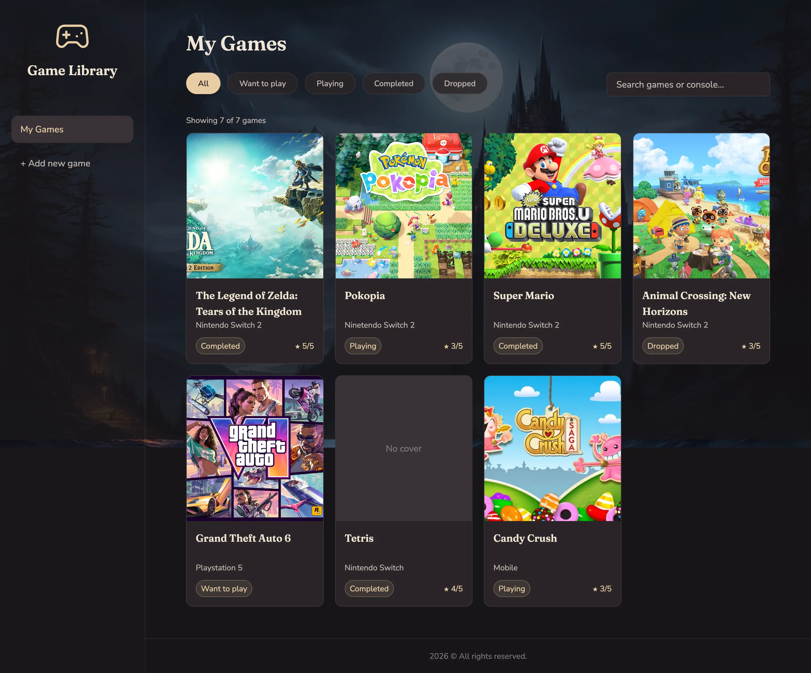
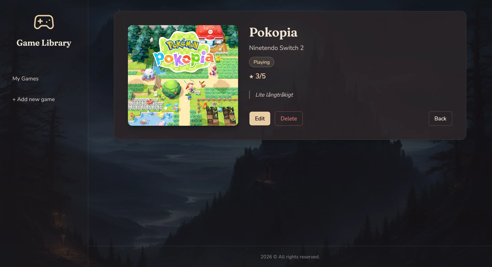
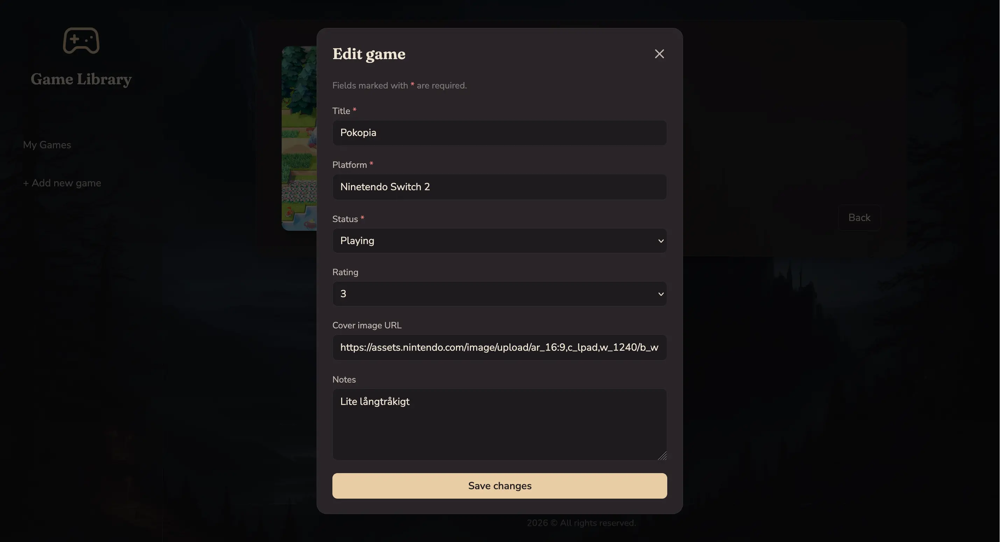
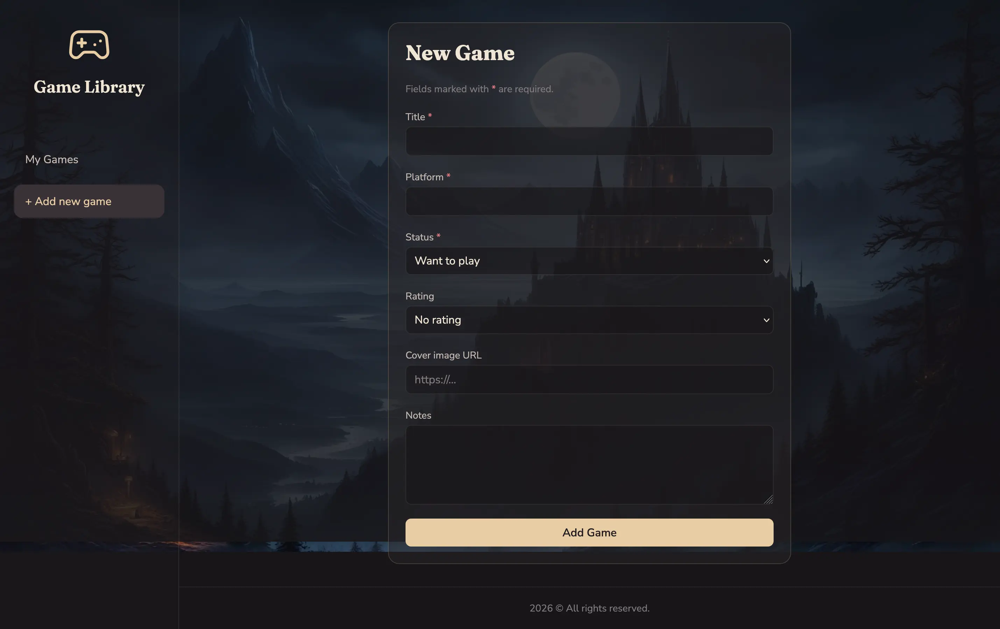

**Tablet**
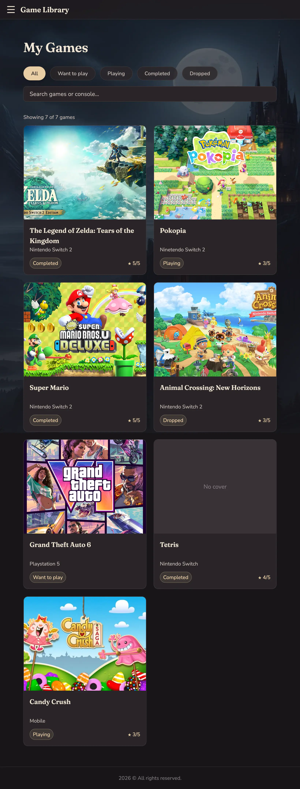
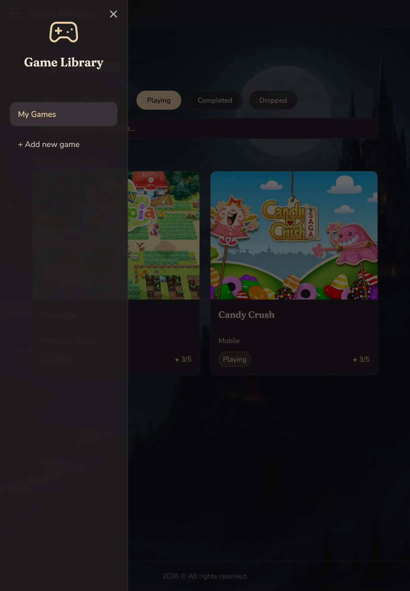
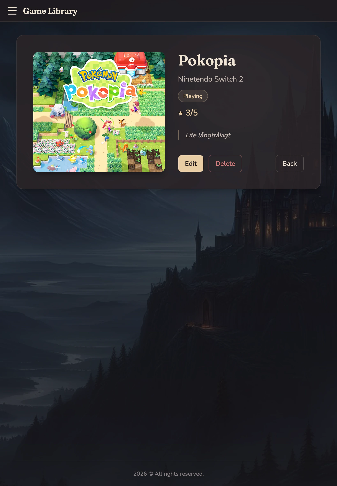
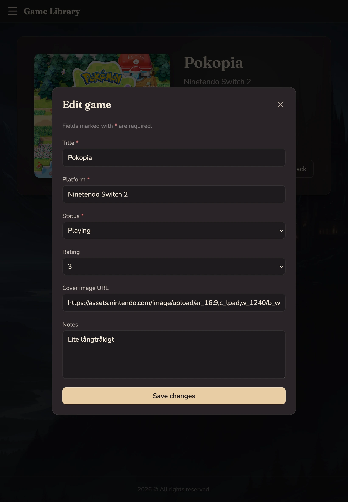
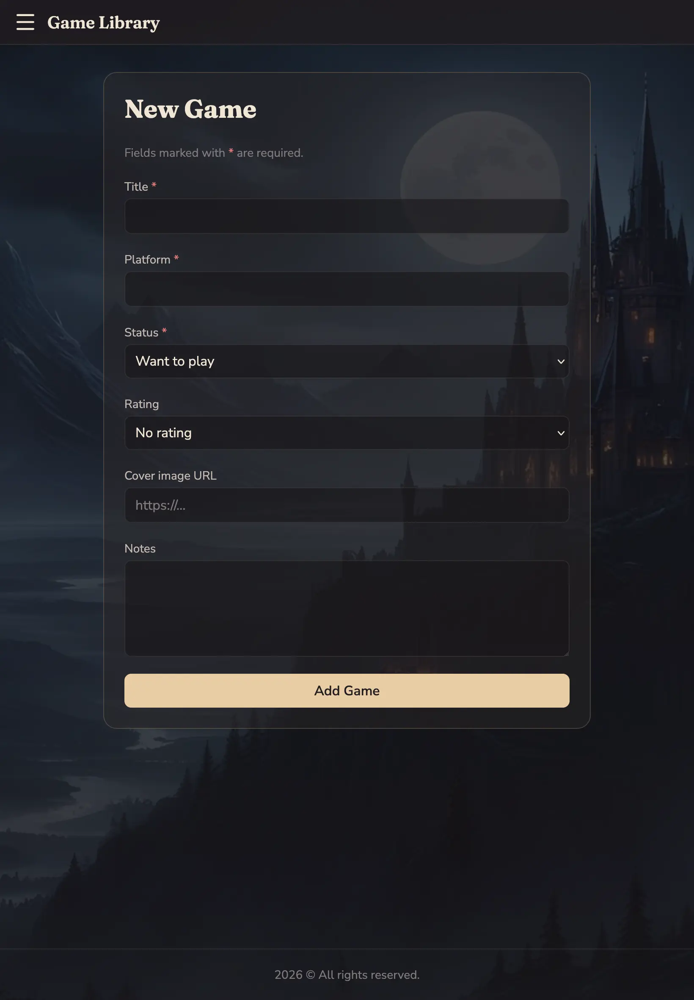

**Mobil**
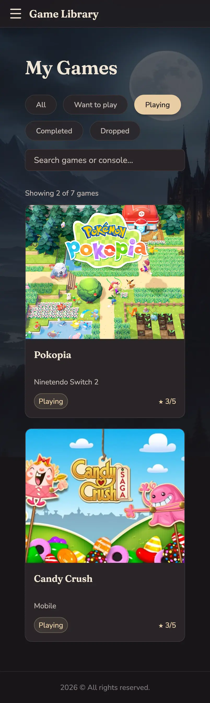
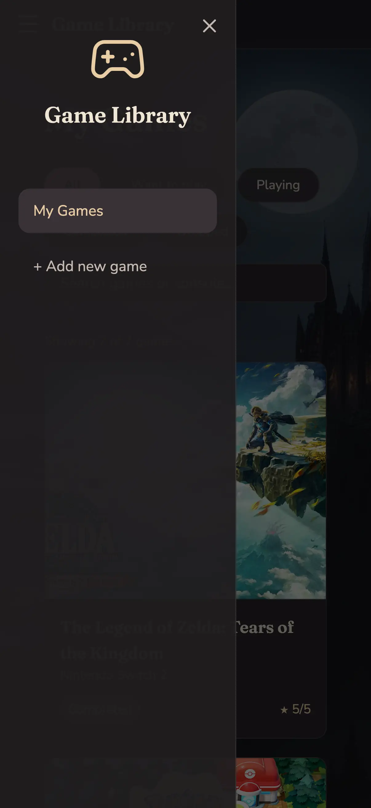
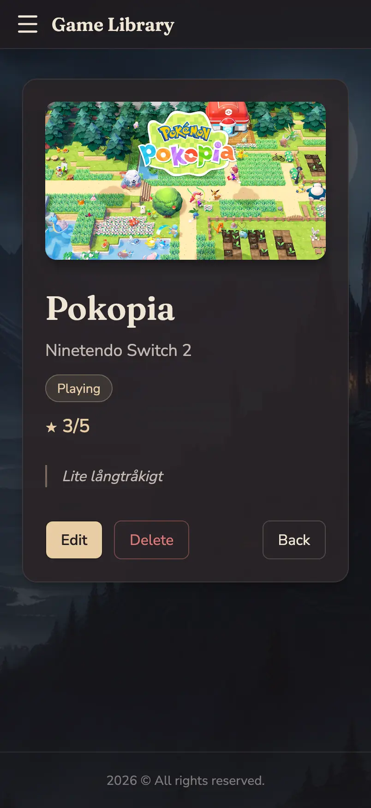
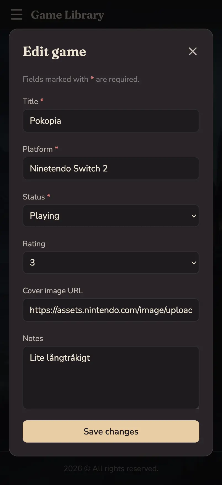
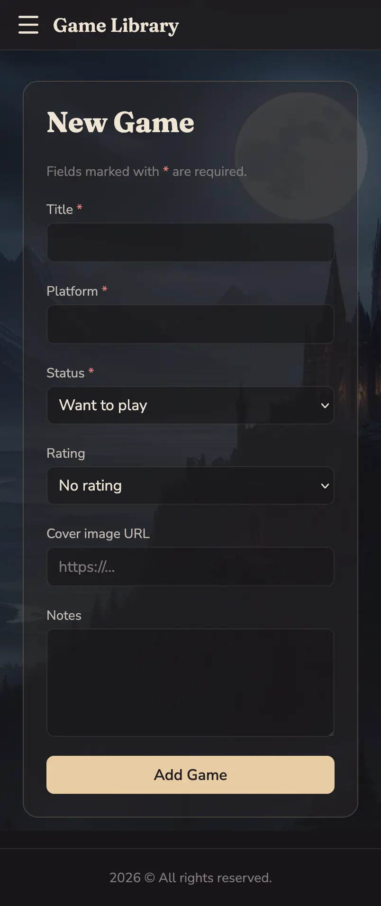

## Tillgänglighet

Lighthouse-analysen gjordes på den publicerade sidan och gav 100 i tillgänglighet.

**Desktop**
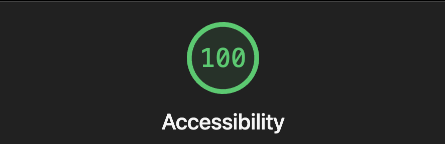

**Mobil**


## API

Appen använder [Questlog API](https://questlog-api.vercel.app/docs). API:t har ingen inloggning, utan spelen sparas under ett valfritt handle. Basadressen, med handle, ligger i `src/config.ts`.

| Metod  | API-adress   | Gör                             | Används i appen             |
| ------ | ------------ | ------------------------------- | --------------------------- |
| GET    | `/games`     | Lista spel, valfritt `?status=` | Startsidan, filtret         |
| GET    | `/games/:id` | Hämta ett spel                  | Specifik spelsida           |
| POST   | `/games`     | Skapa ett spel                  | Formuläret "nytt spel"      |
| PATCH  | `/games/:id` | Ändra ett spel                  | Redigeringsmodalen          |
| DELETE | `/games/:id` | Ta bort ett spel                | Delete-knappen på spelsidan |

## Hooks

All fetch-logik ligger i egna hooks i `src/hooks/`. Komponenterna anropar hooksen och visar resultatet.

Jag följde den föreslagna uppdelningen av custom hooks: `useGames(status)`, `useGame(id)` och `useSaveGame()`.

- **`useGames(status)`** hämtar listan med alla spel, filtrerad på status om en status skickas in. Den returnerar `games`, `isLoading` och `error`. Varje gång filtret ändras hämtas listan på nytt automatiskt.
- **`useGame(id)`** hämtar ett enskilt spel. Den returnerar också `setGame`, så att sidan kan visa det uppdaterade spelet direkt efter en redigering utan en ny hämtning.
- **`useSaveGame()`** innehåller `addGame`, `updateGame` och `deleteGame` (POST, PATCH och DELETE). Den hämtar ingenting när sidan laddas, utan gör något först när en av funktionerna anropas. Den returnerar även `isSaving` och `error`.
- **`useLocalStorage(key, initialValue)`** fungerar som `useState` men hämtar startvärdet från `localStorage` och sparar varje ändring dit. Den används för att komma ihåg det valda statusfiltret.

### Varför jag byggt det så

Jag valde att samla fetch-logiken i egna hooks så att komponenterna kunde fokusera på det som visas och hantera UI medan hooks fick sköta logiken. Jag tycker att det i slutändan gjorde koden lättare att läsa och förstå samt enklare att ändra utan att behöva leta på flera ställen.

Det har dock varit både lärorikt och mycket frustrerande att arbeta med komponenter och custom hooks tillsammans. Det som varit klurigast är att avgöra hur en hook ska utformas och vad den behöver returnera för att fungera i komponenterna. Under arbetet har jag fått en bättre förståelse för hur hooks kan användas för att strukturera och återanvända kod men jag tycker fortfarande att det är svårt att veta vilken information och vilka funktioner som behöver skickas tillbaka.

## Köra projektet lokalt

För att köra projektet lokalt behöver du ha Node.js och npm installerat.

### 1. Klona repot

```bash
git clone https://github.com/isabelletherese/questlog.git
cd questlog
```

### 2. Installera beroenden

```bash
npm install
```

### 3. Starta utvecklingsservern

```bash
npm run dev
```

Öppna adressen som visas i terminalen i din webbläsare. Som standard är det `http://localhost:5173`.

### Tillgängliga script

| Kommando          | Beskrivning                                                        |
| ----------------- | ------------------------------------------------------------------ |
| `npm run dev`     | Startar utvecklingsservern.                                        |
| `npm run build`   | Kontrollerar TypeScript-koden och bygger projektet för produktion. |
| `npm run preview` | Förhandsvisar produktionsbygget lokalt.                            |
| `npm run lint`    | Kontrollerar koden med ESLint.                                     |

## Projektstruktur

```
src/
├── components/   # Sidebar, GameCard, StatusFilter, GameForm, EditGame
├── hooks/        # useGames.ts (useGames, useGame, useSaveGame), useLocalStorage.ts
├── pages/        # Root, Games, GameDetails, NewGame, NotFound
├── types/        # game.ts (Game, GameInput), status.ts (Status, statusLabels)
├── assets/       # bakgrundsbild och skärmdumpar
├── config.ts     # API-adress med handle
└── index.css     # Tailwind-tema, färger och typsnitt
```
